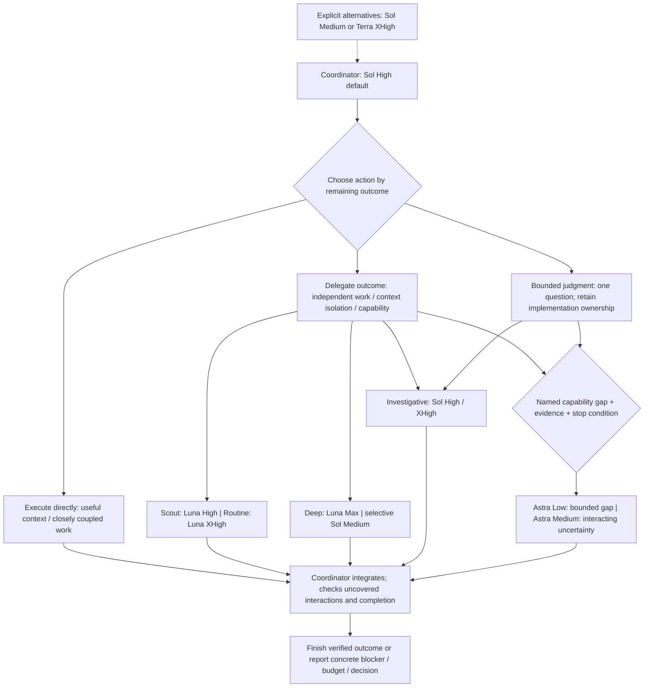

# Goblin Mini Astra

Current skill version: **v10**. The default Coordinator is **GPT-6.1 Sol High**. Sol Medium and Terra XHigh remain explicit alternatives. Sol Low and Sol Max are excluded from standard routing; Luna Max and Astra Low remain available.

Derived from [Goblin Mini Pro](https://github.com/abangkis/goblin-mini-pro). Optimize accepted outcomes, clear communication, responsiveness, and attributable usage without reducing required quality. Profile benefits remain unmeasured in this workflow.

## Modular instructions

| Source | Responsibility | Load when |
| --- | --- | --- |
| [SKILL.md](SKILL.md) | Stable coordination, authorization, delegation, validation, completion, and communication rules | Activating the skill |
| [Model profiles](references/model-profiles.md) | Authoritative Coordinator and worker model/effort mapping | Activation, profile selection, or delegation if not already loaded |
| [Frontend routing](references/frontend-routing.md) | Rendered UI evidence and visual escalation | Frontend/design work |
| Budget references below | Defaults, native setup, measurement, and reporting | Relevant budget decisions |

Change model mappings in the model reference; update user-facing documentation and diagrams to match. The skill contains no automatic model-switching engine. The latest explicit user selection replaces earlier profile choices; host metadata establishes actual runtime. Reloads and model changes preserve the task's scope, approvals, completed work, evidence, budget, native goal, and accumulated usage. A new default does not override an explicit task selection.

## Coordinator actions

1. **Execute directly:** existing context is sufficient, work is closely coupled, or handoff would add more work.
2. **Delegate an outcome:** a worker can own a separable investigation, fix, and validation with a concrete benefit from context isolation, parallelism, or capability.
3. **Request bounded judgment:** obtain an answer to one decision, hypothesis, or evidence gap while retaining implementation ownership.

Do not send work to another Sol High merely because the Coordinator is Sol High or the task is difficult. Same-model delegation remains useful for independent work or a specific second opinion. Reuse passing worker checks; after integration, validate new interactions not already covered. Keep one worker by default, at most two independent workers concurrently, and no worker-created subagents.

The Coordinator checks all requested outcomes before ending. Continue feasible authorized work within budget, or identify the blocker, budget limit, or user decision needed. This applies to `no budget` too, without creating a goal. Communication leads with the outcome and practical consequence, synthesizes worker findings, and retains necessary constraints without a rigid word limit.

## Routing diagram



There is no mandatory escalation ladder. Sol Low/Max require an explicit user request. All delegates share the task budget. Frontend ownership follows the selected Coordinator; Pro is a separate authorized consultation.

## Budget defaults and options

On first use, Codex asks for a default: **1 million**, **5 million**, **10 million tokens**, or **your own positive amount**. No number is selected automatically. This one-time setup also applies to simple tasks. Python 3 is required for the bundled standard-library helper, which returns the setup status; Codex asks the question in conversation rather than opening a terminal prompt.

The choice applies to each new task until explicitly changed:

| Example request | This task | Saved default |
| --- | --- | --- |
| No budget instruction | Uses saved default | Unchanged |
| `Use a budget of 2 million tokens for this task` | 2 million tokens | Unchanged |
| `No budget for this task` | No task token ceiling | Unchanged |
| `Change the default budget to 10 million tokens` | Existing task retains its budget unless asked otherwise | 10 million for future tasks |
| `Change the default to no budget` | Existing task retains its budget unless asked otherwise | No ceiling for future tasks |

Follow-up messages and repeated skill invocations retain the current task budget and accumulated usage. A numeric override changes the task's total ceiling, not an additional allowance. Explicitly request use of the saved default again to clear a task override. `No budget` does not disable efficient routing, validation, or actual-usage reporting.

Preferences live in `$CODEX_HOME/skill-settings/goblin-mini-astra/budget.json` (fallback `~/.codex/skill-settings/goblin-mini-astra/budget.json`). They are local to the user/host, survive skill-folder upgrades, and are not included in this repository. Only an explicit default selection/change writes this file. Task overrides are resolved without modifying it.

See [budget setup and helper commands](references/budget-options.md) for first-use behavior, custom values, errors, and precedence. The helper resolves policy; it does not count tokens or enforce a host-level hard stop. Installing or editing the skill does not start setup or choose your default.

### Native budget setup, usage checks, and reporting

A numeric saved default or explicit task budget includes the user's request to start or reuse a native goal with that budget, without another confirmation. This applies to simple tasks too. The Coordinator inspects existing state, preserves unfinished goals/counters, and verifies native readback before reporting `native configured`. If the previous goal is complete, the new task can start its requested goal directly. `No budget` skips native goal creation and token-budget setup; removing an existing cap requires supported host controls, not clearing usage history. Unsupported setup or conflicting unfinished goals are reported as actual limitations, not renewed permission requests.

Native usage is read at consequential decisions and once for the final report, reusing available metadata. Existing goals and accumulated usage are preserved. Worker accounting is verified separately; known goal usage is reported even when total worker coverage is unknown. The helper explicitly returns `native_budget_state: unchecked` and no usage measurement; Codex performs native tool integration as described in [the native budget reference](references/native-budget.md).

For a shorter explanation aimed at users, including what happens when the budget is close to being reached or has been reached, read [How Goblin Mini Astra budgeting works](references/budget-behavior.md).

For nontrivial tasks, the Coordinator keeps a small task-local checkpoint of the initial budget, measured usage, verified progress, and remaining work. It reuses available metadata and checks fresh usage only when that could change a costly delegation, escalation, investigation, or phase decision. There is no dedicated monitoring agent or periodic polling, and checking costs are part of the tradeoff.

Reserve enough room for integration, validation, and handoff. Low account quota discourages optional work with marginal value, while required validation remains mandatory. A budget is not a spending target. Numeric budgets and native setup are one bundled request; setup never expands authorization for the underlying work.

The final report for nontrivial work includes initial budget/source, native state, actual measured tokens with scope, and accounting coverage. Missing usage is `unavailable` with a reason; `partial` requires an existing scoped measurement. If the ceiling changes mid-task, retain the initial value and report the current ceiling too. Account quota is not task usage. Simple tasks omit routine bookkeeping unless requested, but existing native goals or requested native caps are still checked. Native configuration does not prove exact stopping or in-flight worker coverage. Savings remain unmeasured.

## Install

Ask Codex:

```text
Use $skill-installer to install goblin-mini-astra from
https://github.com/abangkis/goblin-mini-astra
```

Alternatively, copy the skill folder to `~/.codex/skills/goblin-mini-astra/` (or the `skills` directory under your configured `CODEX_HOME`). Include `SKILL.md`, `agents/openai.yaml`, all files in `references/`, and `scripts/budget.py`. Preserve the separate user-settings directory when updating the skill.

## Use

```text
$goblin-mini-astra

Complete the following task, conserving Codex quota while meeting these acceptance criteria:
[task, constraints, and desired outcome]
```

The active mode is `MINI-ASTRA`. A later explicit Goblin mode selection replaces it; asking to stop Goblin mode disables this routing. Discussing or editing the skill does not activate execution mode.

Active task responses end with the loaded skill version, for example:

```text
Active Goblin Mode: MINI-ASTRA v10 | Execution footprint: Coordinator.
```

This identifies the skill instructions in use, not the model version. Existing tasks must load updated instructions before reporting a newer skill version.

### Reload in an existing task

Copy this prompt into the task to reload the installed instructions without restarting its work:

```text
$goblin-mini-astra

Read C:\Users\Force\.codex\skills\goblin-mini-astra\SKILL.md from disk and apply the version you actually read, including its relevant references. Confirm the loaded version.

Preserve this task's scope, approvals, completed work, effective budget, native goal, and accumulated usage. Do not restart the task or reset counters. Reloading the skill does not change this task's model.
```

Replace the path if your installed skill is in a different location. To match a supported Coordinator profile, select GPT-6.1 Sol High (default), Sol Medium, or Terra XHigh separately in the host's model controls.

## Optional GPT Pro consultation

Pro is a separate decision or audit consultation, never an implied Astra capability or an execution worker. A consultation requires a real Pro target and explicit authorization for the handoff. Required but unavailable Pro consultation pauses dependent execution; optional consultation does not block routine work.

Pro recommendations are checked against current evidence before implementation. Material conflicts require a revised aligned decision or an explicitly approved documented resolution. The detailed procedure is loaded only when needed from [the Pro gate reference](references/pro-decision-gate.md).

## Validation status

Run helper behavior tests with `python -B -m unittest discover -s tests -v`. Tests use project-local isolated settings, covering first-use setup, saved presets/custom defaults, task overrides, no-budget behavior, invalid data, persistence across processes, and no false claims of native measurement/configuration. They do not alter personal preferences or create native goals. Native goal control and aggregate worker enforcement require live host validation; these tests do not prove them. The v10 update modularizes model selection and frontend routing, adds three explicit Coordinator actions, and preserves the budget helper. Eight budget helper tests passed, along with restricted structure, local-link, version, and model-separation checks. An independent read-only review of five routing scenarios found no material routing contradiction; it was a policy review, not live execution. The official quick_validate.py remains unavailable because PyYAML is missing. No live model-quality or latency benchmark has been performed.


## License

[MIT](LICENSE), copyright (c) 2026 abangkis.
