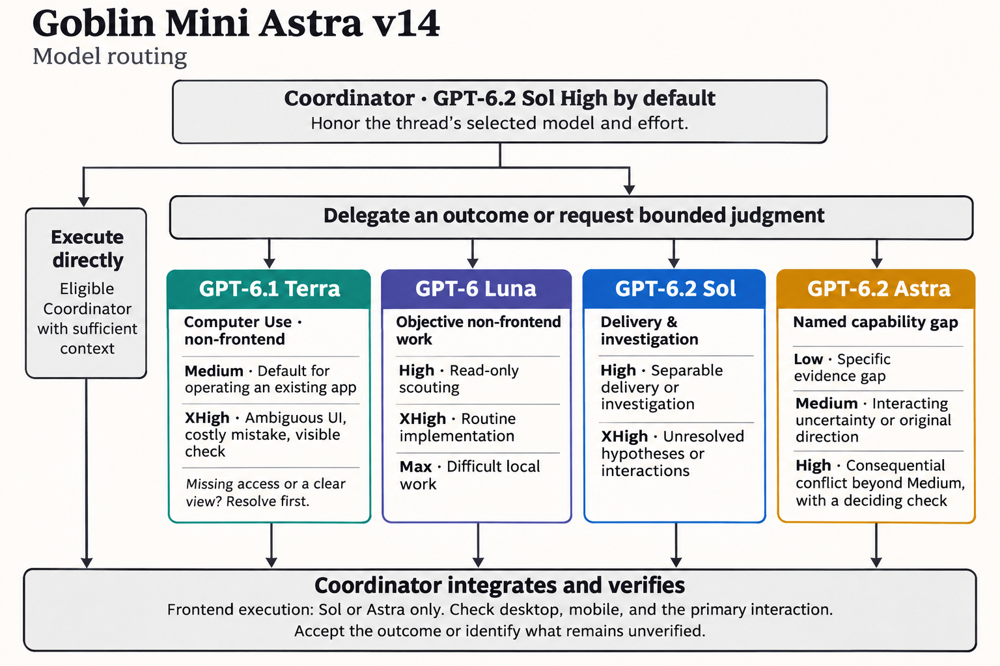

# Goblin Mini Astra v14

Goblin Mini Astra helps Codex conserve quota by keeping work with the Coordinator when it has enough context and delegating when a worker can improve the outcome. The recommended Coordinator is **GPT-6.2 Sol High**. Select it in Codex or keep the model you already use.

<a id="routing-diagram"></a>



[View detailed routing](references/model-profiles.md#routing-diagram)

## Quick start

**Install.** Ask Codex to install the skill. The bundled budget helper requires Python 3.

```text
Use $skill-installer to install goblin-mini-astra from https://github.com/abangkis/goblin-mini-astra
```

**Use.** Invoke the skill in the thread where you want the work done. Describe the outcome and how you will check it.

```text
$goblin-mini-astra
Fix the checkout form so pressing Enter submits it once. Verify the keyboard interaction on desktop and mobile.
```

The skill stays active for follow-ups in that task until you stop it or select another Goblin mode. The footer shows the skill version Codex actually loaded and which roles took part.

<a id="reload-in-an-existing-task"></a>

<details>
<summary>Reload in an existing thread</summary>

After updating the installed skill, paste this into the thread. To use the recommended Coordinator, first select GPT-6.2 Sol with High reasoning effort in the host.

```text
$goblin-mini-astra
Read skills/goblin-mini-astra/SKILL.md under CODEX_HOME (default ~/.codex). From that skill directory, read references/model-profiles.md and any references relevant to this task. Apply and confirm the version you actually read.
Preserve this thread's scope, approvals, completed work, model selection, effective budget, native goal, and accumulated usage. Reload in place without restarting the task or resetting counters.
```

</details>

## Budget

On first use, choose **1 million**, **5 million**, **10 million** tokens, or a custom positive amount. Codex saves the choice locally for future tasks. You can also explicitly set a default of `no budget`.

| What you want | What to tell Codex |
| --- | --- |
| Use the saved default | Invoke the skill and give it the task. |
| Set a ceiling for this task only | “Use a budget of 2 million tokens for this task.” |
| Skip the ceiling for this task only | “No budget for this task.” |
| Change the default for future tasks | “Change my default budget to 10 million tokens.” |

If you raise the budget during a task, the new number is the total ceiling. For example, raising it from 1 million to 2 million tokens after spending 600,000 leaves 1.4 million for the rest of the task. Your saved default survives skill updates.

A numeric budget requests native setup where the host supports it. The Coordinator checks the configured ceiling and shares it with workers. A task override leaves the saved default intact. Follow-ups retain accumulated usage. For larger tasks, the final report identifies the usage that Codex could measure. [Budget behavior](references/budget-behavior.md) · [Setup and overrides](references/budget-options.md) · [Native setup and accounting](references/native-budget.md)

## Reference

- [Coordinator instructions](SKILL.md) cover scope, delegation, verification, and completion.
- [Model profiles](references/model-profiles.md) explain worker selection, Computer Use, Blender, and selective escalation.
- [Frontend routing](references/frontend-routing.md) covers design ownership and the desktop, mobile, and interaction evidence used for acceptance.
- [GPT Pro consultation](references/pro-decision-gate.md) describes when to request an explicitly authorized decision or audit.
- [Budget helper tests](tests/test_budget.py) use isolated settings. Run them from the repository root with `python -B -m unittest discover -s tests -v`.

Derived from [Goblin Mini Pro](https://github.com/abangkis/goblin-mini-pro). Quota savings for this workflow remain unmeasured.

## License

[MIT](LICENSE), copyright (c) 2026 abangkis.
