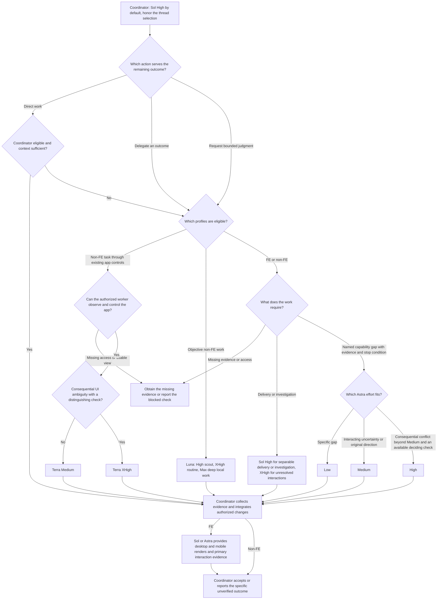

# Model profiles

Use this table for Coordinator selection and all worker assignments. Choose the action in [SKILL.md](../SKILL.md), then match the remaining work to an eligible profile. A requested model and effort describe the intended runtime. Verify them against host metadata when available.

| Work | Model / effort | When to choose it |
| --- | --- | --- |
| Coordinate | `gpt-6.2-sol` / `high` by default | Own scope, communication, routing, integration, and acceptance. Execute directly when existing context is sufficient and the Coordinator is eligible for the work. |
| Objective non-FE work | `gpt-6-luna` / `high`, `xhigh`, or `max` | High for bounded read-only scouting, XHigh for routine implementation or debugging, Max for a difficult local problem with objective checks. |
| Delegated delivery, design, or investigation | `gpt-6.2-sol` / `high` or `xhigh` | High for separable delivery, open design decisions, complex implementation, or an independent investigation. Choose XHigh for specific competing hypotheses, interactions, or edge cases. |
| Computer Use worker | `gpt-6.1-terra` / `medium` by default, selectively `xhigh` | Operate an existing application through visible controls when the next action depends on screen state. Request the effort explicitly at dispatch. |
| Bounded capability gap | `gpt-6.2-astra` / `low` | Answer one unresolved technical question or correct one observed visual or interaction defect. |
| Escalation | `gpt-6.2-astra` / `medium` or selectively `high` | Medium for interacting uncertainties, consequential architecture, original visual direction, or experience-wide tradeoffs. Use High only when the conditions below hold. |

Use only Sol or Astra for **all FE execution**, including scouting and UI testing. Apply [frontend routing](frontend-routing.md) for FE ownership and acceptance. An eligible Coordinator handles bounded work directly at its current effort when context is sufficient. A same-profile handoff needs a concrete benefit. Sol Low and Sol Max require an explicit user request and host support.

## Selecting Computer Use work

Choose by outcome. Entering approved records into an existing app qualifies. Reproducing a product bug or testing a frontend change belongs to Sol or Astra even when the same app and clicks are involved. Prefer an available, suitable structured tool. Delegate UI operation only when it adds value and the worker has the tool access and authorization needed for that session.

Request Terra Medium for known steps with observable results. Choose XHigh directly when plausible interpretations of the UI would lead to materially different actions, choosing incorrectly would cause significant rework, and a visible check can distinguish them. For example, inspect the active object and edit mode before applying a Blender add-on to a selection. If the viewport is unreadable, obtain a usable view first. Terra High is available on explicit request.

For Blender, route Python, background rendering, and MCP calls that run `bpy` to the Sol scripting route. A viewport screenshot can validate a script without a UI handoff. Use the Terra profile for actual interactive control. Consider Astra Medium for a bounded question about conflicting geometry, simulation, or render evidence. Follow the project's UI-session permissions.

## Selecting Astra effort

Apply the capability escalation criteria in [SKILL.md](../SKILL.md) to every Astra assignment. Select the effort directly from the evidence.

Choose High when the wrong decision would cause material harm or rework, credible explanations or constraints conflict, and an available check can distinguish the options. Before assigning it, state which decision Medium is unlikely to settle and why, what evidence the worker can inspect, and what result ends the assignment. Keep room in the shared task budget for integration and validation.

For example, a migration rehearsal may pass on each schema separately while a rollback trace shows both old and new writers active. High can resolve which write order preserves acknowledged updates by checking the competing orders against that trace. Medium can handle a cross-service migration when the contracts and acceptance test already settle that question. Missing traces call for evidence collection. Task size, a request for a premium look, or a failed tool call alone gives no reason to select High.

High is an effort choice within the escalation assignment. A prior Medium attempt is optional. Use bounded judgment for a decision alone. When authorized, one worker can own diagnosis, the closely coupled fix, and its targeted test. Stop when the agreed check settles the decision or the necessary evidence is unavailable.

[GPT Pro consultation](pro-decision-gate.md) requires separate authorization and an available Pro target. Model labels alone establish neither runtime nor measured quota savings.

## Routing diagram

Each assignment keeps its original action and authorization. Bounded judgment returns a decision and evidence. Delegated delivery includes the closely coupled fix and validation when authorized. The Coordinator reserves budget for acceptance.
